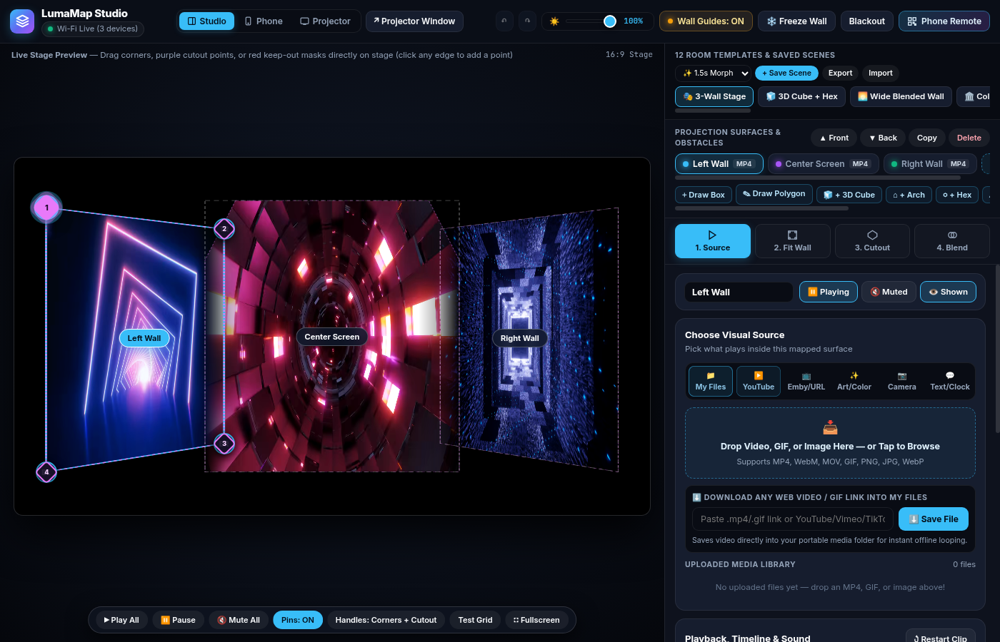
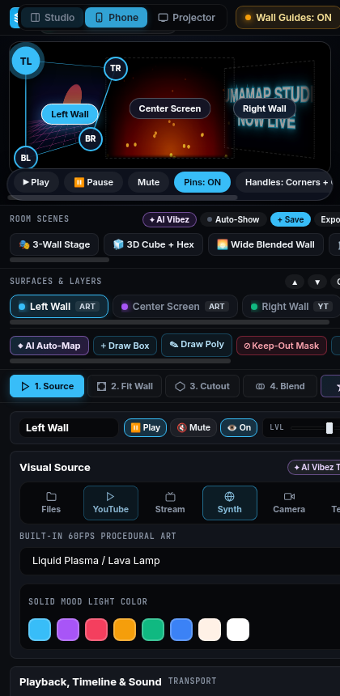

# README

<p align="center">
  
</p>

# LumaMap Studio (vpt9)

> **Simple, high-performance, and beautiful live projection mapping.**  
> Map multiple 3D perspective-warped surfaces, polygon cutouts, and soft-edge blending onto walls, canvases, or physical structures — with real-time phone remote control over local Wi-Fi.

---

## ⚡ Active Application: `lumamap-portable/`

**LumaMap Studio** is the flagship application in this repository. It is a lightweight, zero-jargon projection mapping suite designed for ease of use, instant setup, and rock-solid live performance:

- **Interactive Visual Studio (`/`)**: Drag-and-drop 3D corner-pinning, real-time stage calibration, 12 instant room presets, and contextual inspector controls.
- **Dedicated Projector Window (`/?mode=projector`)**: 100% chromeless, edge-to-edge hardware-accelerated canvas for your projector (`F` for true fullscreen).
- **Wi-Fi Mobile Remote (`/?mode=remote`)**: Instant smartphone control with a precision thumb-trackpad, corner switcher, and scene recall.
- **Rich Source Engine**:
  - **📁 Local Media Library**: Native MP4, WebM, MOV, GIF, PNG, JPG, and WebP playback with playlist auto-advance.
  - **▶️ YouTube Integration**: Dual-engine playback (instant iframe loops + clean background MP4 streaming via `yt-dlp`).
  - **📺 Emby Media Server**: Connect directly to your Emby server or pull the currently playing movie in 1 tap.
  - **✨ Procedural Shaders & Color**: 7 built-in 60fps GLSL shaders and architectural mood wash lighting.
  - **📷 Live Camera / Capture Card**: Ultra-low latency webcam and USB HDMI capture card input.
- **Geometric Warping & Cutouts**:
  - 4-corner perspective warping with internal video pan/zoom/rotation.
  - N-point arbitrary polygon mask cutouts with edge feathering and invert (hole-punch) modes.
  - 4-edge independent soft-edge blending (linear / smoothstep) with gamma correction.
- **Single-File Portability**: Runs either via Python (`server.py`) or as a standalone zero-install HTML5 file (`lumamap_studio_v2.html`).

<p align="center">
  
</p>

---

## 🚀 Quick Start

### 1. Python Server (Recommended for Media Library, Emby & YouTube Caching)

```bash
# Clone the repository
git clone https://github.com/ghively/vpt9.git
cd vpt9/lumamap-portable

# Install dependencies (FastAPI, Uvicorn, yt-dlp, qrcode, pillow)
pip install -r requirements.txt

# Run server
python server.py
# (On macOS/Linux: ./run.sh | On Windows: double-click run.bat)
```

Open **`http://localhost:8080`** in your browser.

### 2. Standalone Zero-Install Mode
Double-click **`lumamap_studio_v2.html`** in any web browser. No server, terminal, or dependencies required!

---

## 🗺️ Project Roadmap

The core projection mapping engine is feature-complete. The following items are planned for future releases:

- [ ] **1. Audio-Reactive / Microphone Beat Pulse**
  - Real-time Web Audio API FFT analysis of room audio via microphone or line-in.
  - Audio-reactive parameter modulation: pulse brightness, zoom scale, edge feather, or shader speed to the bass/beat of room music.
- [ ] **2. Built-in Text, Signage & Live Clock Overlay Source**
  - Dedicated 5th visual source generator for dynamic text rendering on any surface.
  - Customizable fonts, neon glowing outlines, scrolling ticker marquees, and live digital clock / countdown timers.
- [ ] **3. Auto-Show / Ambient Scene Sequencer**
  - Hands-free playlist sequencer for saved Room Scenes.
  - Timed automatic switching (every $N$ minutes) with configurable smooth morph/fade transitions between scenes.
- [ ] **4. Prompt-Based "Vibez" (AI Room Theme Generator)**
  - Type a text prompt (e.g. *"cyberpunk ramen bar"*, *"cozy rainy autumn cabin"*, *"deep space nebula meditation"*) and let AI generate or select matching shaders, mood color washes, video loops, and surface configs to instantly transform the entire room's vibe.
- [ ] **5. AI Auto-Room Mapping via Camera / Webcam**
  - Computer-vision & AI edge/corner detection via webcam or phone camera.
  - Automatically identifies physical picture frames, walls, doorways, and obstacles in the projection field and snaps calibrated polygon surfaces onto them with one tap.

---

## 🏛️ Repository Architecture & Status

| Directory / Component | Status | Description |
|---|---|---|
| **`lumamap-portable/`** | **Active / Current** | Python FastAPI + WebSockets + WebGL/Canvas projection studio, phone remote, and media server. |
| **`lumamap_studio_v2.html`** | **Active / Standalone** | Self-contained single-file HTML5 distribution of LumaMap Studio. |
| **`control-panel/`** | **Legacy Reference** | Node/React/WebGL2 reimplementation of VPT8. Maintained as an architectural and algorithmic reference. |
| **`docs/`** | **Reference & Specs** | Documentation, parity audits, and historical specifications. |
| **`vpt8-source-archive`** (git tag) | **Archived** | Original Cycling '74 Max/MSP source code (preserved at tag `vpt8-source-archive`). |

---

## 🤖 AI Development & Contributor Guide

If you are an AI assistant or human developer working on this codebase:

- **Primary Working Directory**: [`lumamap-portable/`](lumamap-portable/)
  - Main application logic & UI: [`lumamap-portable/static/index.html`](lumamap-portable/static/index.html)
  - Backend server & WebSocket sync: [`lumamap-portable/server.py`](lumamap-portable/server.py)
  - Standalone release bundle: [`lumamap_studio_v2.html`](lumamap_studio_v2.html)
- **Guidelines**:
  - Always keep `lumamap-portable/static/index.html` and `lumamap_studio_v2.html` synchronized when updating front-end capabilities.
  - Follow [`AGENTS.md`](AGENTS.md) and [`CLAUDE.md`](CLAUDE.md) for repository rules, AI conventions, and test commands.
  - Keep changes performant: ensure 60fps rendering in the WebGL and Canvas compositors.

---

## 📄 License

- LumaMap Studio and `control-panel/` are licensed under the **MIT License** — see [`LICENSE`](LICENSE).
- The archived VPT8 Max/MSP historical source (git tag `vpt8-source-archive`) is licensed CC BY-NC-SA 3.0 Unported.
