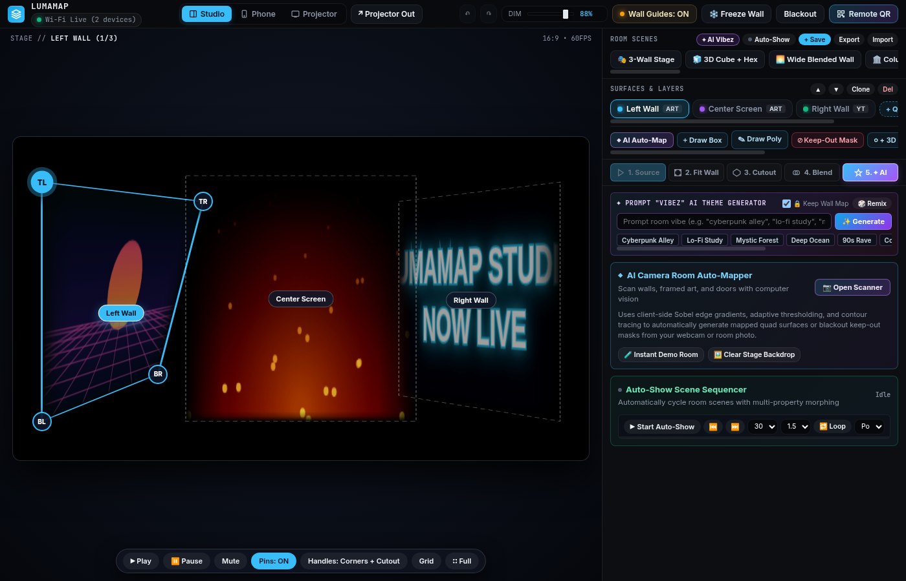

# README

<p align="center">
  
</p>

# LumaMap Studio (vpt9)

> **Simple, high-performance, and beautiful live projection mapping.**  
> Map multiple 3D perspective-warped surfaces, polygon cutouts, and soft-edge blending onto walls, canvases, or physical structures — with real-time phone remote control over local Wi-Fi.

---

## ⚡ Active Application: `lumamap-portable/`

**LumaMap Studio** is the flagship application in this repository. It is a lightweight, zero-jargon projection mapping suite designed for ease of use, instant setup, and rock-solid live performance:

- **Interactive Visual Studio (`/`)**: Drag-and-drop 3D corner-pinning, real-time stage calibration, 12 instant room presets, and contextual inspector controls.
- **Dedicated Projector Window (`/?mode=projector`)**: 100% chromeless, edge-to-edge hardware-accelerated canvas for your projector (`F` for true fullscreen).
- **Wi-Fi Mobile Remote (`/?mode=remote`)**: Instant smartphone control with a precision thumb-trackpad, corner switcher, and scene recall.
- **Dedicated 5-Tab Workflow & AI Studio (`5. ✦ AI`)**:
  - **✦ Prompt-Based "Vibez" AI Theme Generator**: Natural language room theme generator with 10 semantic archetypes (*Cyberpunk Alley, Lo-Fi Study, Mystic Forest, Deep Ocean Bioluminescence, 90s Rave Warehouse, Cozy Hearth, Cosmic Space, Zen Spa, Liquid 70s, Retro Arcade*), 4 new 60fps procedural shaders (`fireflies`, `biolum`, `lofiRain`, `emberGlow`), modifier parser, `🔒 Keep Wall Map` geometry lock, and optional LLM/Ollama backend (`POST /api/vibez/generate`).
  - **⌖ AI Camera Room Auto-Mapper**: In-browser computer vision pipeline (Sobel gradients, integral-image adaptive thresholding, morphological closing, contour tracing, and RDP simplification) to automatically detect physical walls, framed art, doors, and TVs from a webcam feed or room photo snapshot. Includes Projector Flash Diff calibration and a Synthetic Demo Room.
  - **⟳ Auto-Show / Ambient Scene Sequencer**: Hands-free timer sequencer (`10s`–`10m`) that cycles through saved room looks with smooth multi-property scene morphing across quad corners, polygon cutouts, opacity, blend modes, and color grading.
- **Rich Source Engine**:
  - **💬 Dynamic Text, Neon Signage & Live Clock**: Glowing neon signs with multi-pass bloom, scrolling marquee tickers, live digital clock & date, and event countdown timers.
  - **📁 Local Media Library**: Native MP4, WebM, MOV, GIF, PNG, JPG, and WebP playback with playlist auto-advance.
  - **▶️ YouTube Integration**: Dual-engine playback (instant iframe loops + clean background MP4 streaming via `yt-dlp`).
  - **📺 Emby Media Server**: Connect directly to your Emby server or pull the currently playing movie in 1 tap.
  - **✨ Procedural Shaders & Color**: 11 built-in 60fps GLSL shaders and architectural mood wash lighting.
  - **📷 Live Camera / Capture Card**: Ultra-low latency webcam and USB HDMI capture card input.
- **Dual-Source Audio Beat Reactivity**:
  - Live 256-bin FFT spectrum analyzer reacting either to **internal video/stream sound** directly OR to **room music via microphone/line-in**.
  - Dynamic modulation: bass kick brightness strobe, subwoofer kick scale, procedural shader acceleration, and neon text glow pulse.
- **Geometric Warping, Cutouts & Opacity**:
  - 4-corner perspective warping with internal video pan/zoom/rotation.
  - Quick-access **Layer Opacity fader (0–100%)** persistent across all inspector steps.
  - N-point arbitrary polygon mask cutouts with edge feathering and invert (hole-punch) modes.
  - 4-edge independent soft-edge blending (linear / smoothstep) with gamma correction.
- **Single-File Portability**: Runs either via Python (`server.py`) or as a standalone zero-install HTML5 file (`lumamap_studio_v2.html`).

<p align="center">
  
</p>

<p align="center">
  
</p>

---

## 🚀 Quick Start

### 1. Python Server (Recommended for Media Library, Emby & YouTube Caching)

```bash
# Clone the repository
git clone https://github.com/ghively/vpt9.git
cd vpt9/lumamap-portable

# Install dependencies (FastAPI, Uvicorn, yt-dlp, qrcode, pillow)
pip install -r requirements.txt

# Run server
python server.py
# (On macOS/Linux: ./run.sh | On Windows: double-click run.bat)
```

Open **`http://localhost:8080`** in your browser.

### 2. Standalone Zero-Install Mode
Double-click **`lumamap_studio_v2.html`** in any web browser. No server, terminal, or dependencies required!

---

## 🗺️ Project Roadmap

### ✅ Completed Features
- [x] **Prompt-Based "Vibez" (AI Room Theme Generator)** (Natural-language prompt theme synthesis, 10 room archetypes, 4 new shaders, Keep Wall Map geometry lock, and optional LLM/Ollama backend).
- [x] **AI Auto-Room Mapping via Camera / Webcam** (In-browser CV pipeline with Sobel + adaptive thresholding, contour tracing, quad approximation, Projector Flash Diff calibration, and Demo Room).
- [x] **Auto-Show / Ambient Scene Sequencer** (Hands-free interval timer, multi-property scene morphing across corners, cutouts, blend, color grading, loop/shuffle modes, and live progress bar).
- [x] **Built-in Text, Signage & Live Clock Overlay Source** (Neon tube glow, scrolling marquees, live clock & date, event countdown timers).
- [x] **Dual-Source Audio Beat Reactivity** (Internal video sound + room mic FFT analyzer with kick brightness, subwoofer scale, and shader tempo modulation).
- [x] **Hardware-Grade UI & 5-Step Workflow Streamlining** (Anodized obsidian palette, tabular numerals, 5 clear workflow tabs: `1. Source`, `2. Fit Wall`, `3. Cutout`, `4. Blend`, `5. ✦ AI`).

---

## 🏛️ Repository Architecture & Status

| Directory / Component | Status | Description |
|---|---|---|
| **`lumamap-portable/`** | **Active / Current** | Python FastAPI + WebSockets + WebGL/Canvas projection studio, phone remote, and media server. |
| **`lumamap_studio_v2.html`** | **Active / Standalone** | Self-contained single-file HTML5 distribution of LumaMap Studio. |
| **`control-panel/`** | **Legacy Reference** | Node/React/WebGL2 reimplementation of VPT8. Maintained as an architectural and algorithmic reference. |
| **`docs/`** | **Reference & Specs** | Documentation, parity audits, and historical specifications. |
| **`vpt8-source-archive`** (git tag) | **Archived** | Original Cycling '74 Max/MSP source code (preserved at tag `vpt8-source-archive`). |

---

## 🤖 AI Development & Contributor Guide

If you are an AI assistant or human developer working on this codebase:

- **Primary Working Directory**: [`lumamap-portable/`](lumamap-portable/)
  - Main application logic & UI: [`lumamap-portable/static/index.html`](lumamap-portable/static/index.html)
  - Backend server & WebSocket sync: [`lumamap-portable/server.py`](lumamap-portable/server.py)
  - Standalone release bundle: [`lumamap_studio_v2.html`](lumamap_studio_v2.html)
- **Guidelines**:
  - Always keep `lumamap-portable/static/index.html` and `lumamap_studio_v2.html` synchronized when updating front-end capabilities.
  - Follow [`AGENTS.md`](AGENTS.md) and [`CLAUDE.md`](CLAUDE.md) for repository rules, AI conventions, and test commands.
  - Keep changes performant: ensure 60fps rendering in the WebGL and Canvas compositors.

---

## 📄 License

- LumaMap Studio and `control-panel/` are licensed under the **MIT License** — see [`LICENSE`](LICENSE).
- The archived VPT8 Max/MSP historical source (git tag `vpt8-source-archive`) is licensed CC BY-NC-SA 3.0 Unported.
